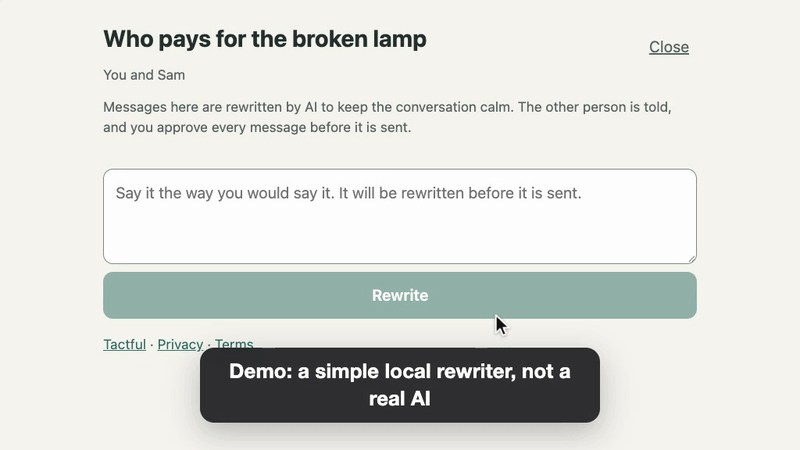

# Tactful (working name)

A chat for two people who have a problem to solve. You write what you want to say, in your own words. AI rewrites it into a calmer, more tactful version, you check it, and only that version reaches the other person.



*Demo of the real app. The rewrite in it is the built in local rewriter (simple rules), not a real AI.* Project page: https://abozaralizadeh.github.io/Tactful/

Source available, free for non-commercial use ([PolyForm Noncommercial 1.0.0](LICENSE)).

## What it does

- One person starts a chat and sends the other an invite link. No accounts, no passwords.
- The other person reads what the app does, confirms they're 18 or over, agrees to AI rewriting, and joins.
- You write a message. It's rewritten. You see the new version and send it, edit it, ask for another, or cancel.
- The other person only gets the rewritten version, marked "rewritten". They never see your original.
- Threats and similar are stopped, not sent. If the rewrite fails for any reason, nothing is sent.
- Either person can close the chat. It's deleted 30 days later.

## Status

Early. It works end to end and has automated tests, but:

- The rewrite runs on a **local fake** made of simple rules, so you can try everything for free. A Claude provider is written but has only been tested against a stubbed response, never the real API.
- The 50 message rewrite test can't be scored for real until a real provider is plugged in.
- It has only been tried in a desktop browser, with two windows as two people.
- The privacy notice and terms in the app are templates. Fill them in and get them reviewed before real use.

There's no live demo you can click. The app needs a server and a database, so it can't run as a static page. The recording above is the real app. Run it yourself, it takes a minute.

## Quick install

You need Node.js 24 or newer.

```bash
git clone https://github.com/abozaralizadeh/Tactful.git
cd Tactful
npm install
npm run build
npm start
```

Open http://127.0.0.1:3000, start a conversation, and open the invite link in a second browser window to be the other person.

For development with live reload, run `npm run dev:server` and `npm run dev:web` in two terminals and open http://localhost:5173. In VS Code, the "Backend + Frontend" launch config does both and attaches debuggers.

## Tests

```bash
npm test
```

```bash
npm run typecheck
```

The 50 heated example messages (writes a table to `reports/rewrite-test.md`):

```bash
npm run rewrite-test
```

With the fake it scores about 42 of 50. That only shows the harness works. The bar is 45 of 50 with every threat stopped, and it needs a real provider to mean anything.

A load test with the fake rewriter and an in memory database. The arguments are the number of pairs and the messages per person:

```bash
npm run load-test -- 200 5
```

Counts from the database (what people did, rewrite results and times, no message text). Point `DB_PATH` at your database:

```bash
npm run stats
```

## Settings

Copy `.env.example` to `.env`. Never commit `.env`.

| Setting | Default | What it does |
| --- | --- | --- |
| `REWRITER` | `fake` | `fake` (free, local) or `anthropic` (paid, needs `ANTHROPIC_API_KEY`) |
| `RETENTION_DAYS` | 30 | How long a closed or quiet conversation is kept |
| `DRAFT_TTL_MINUTES` | 60 | How long an unsent preview lives |
| `DAILY_REWRITE_CAP` | 2000 | Most rewrites per day across the whole service |
| `RATE_*` | see file | Per person and per client limits |
| `LOG_MAX_BYTES`, `LOG_MAX_FILES` | 10 MB, 5 | Size limit for `logs/tactful.log` |

`REWRITER=anthropic` makes real, paid API calls, one per rewrite, retry and edit check. It does nothing until you set it and add a key yourself.

## Run it on a Linux server

From the project folder:

```bash
sudo ./setup_service.sh
```

It installs Node, builds the app, creates a `tactful.service` systemd unit and starts it. Run it again any time to update and restart. For HTTPS with Caddy, give it your domain: `sudo DOMAIN=chat.example.com ./setup_service.sh`. Logs:

```bash
journalctl -u tactful.service -f
```

A size limited copy is also in `logs/tactful.log`. Logs never contain message text.

## Project layout

```
server/          Fastify backend, SQLite, the rewriter interface, cleanup job
server/rewriter/ fake.ts (local rules) and anthropic.ts (real provider)
web/             React app (Vite)
tests/           automated tests
scripts/         the 50 message rewrite test, load test and stats
data/            the 50 test messages
docs/            design, flows, data handling, roadmap
site/            the project page for GitHub Pages
```

## Documents

| File | What's in it |
| --- | --- |
| [docs/DESIGN.md](docs/DESIGN.md) | Architecture, data model, API, key decisions |
| [docs/LOGICAL-FLOW.md](docs/LOGICAL-FLOW.md) | The main flows with diagrams |
| [docs/DATA-HANDLING.md](docs/DATA-HANDLING.md) | What is stored, for how long, and who sees it |
| [docs/ROADMAP.md](docs/ROADMAP.md) | Where it stands and what could come next |

## Contributing

Issues and pull requests are welcome. Please read [CONTRIBUTING.md](CONTRIBUTING.md) first: contributions are accepted only if you agree that they can be relicensed, commercially too. Security problems go through [SECURITY.md](SECURITY.md), not public issues.

## License

Source available, free for non-commercial use under the [PolyForm Noncommercial License 1.0.0](LICENSE). Personal use (study, research, hobby projects and the like) is fine, and so is use by charities, schools, public research bodies and government. The license has the exact terms. Commercial use needs written permission: ask by opening a GitHub issue.

Dependencies keep their own licenses, see [THIRD_PARTY_NOTICES.md](THIRD_PARTY_NOTICES.md).
