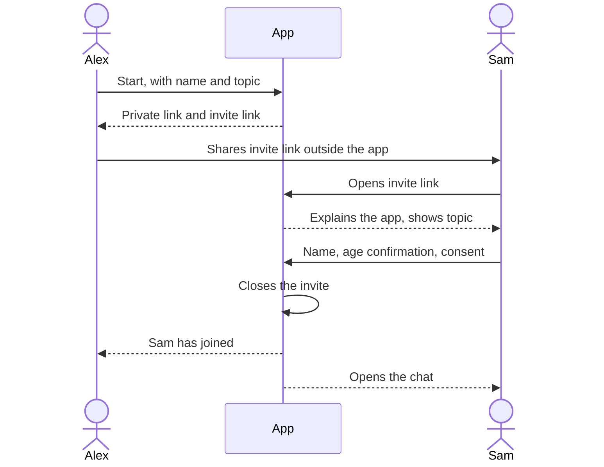
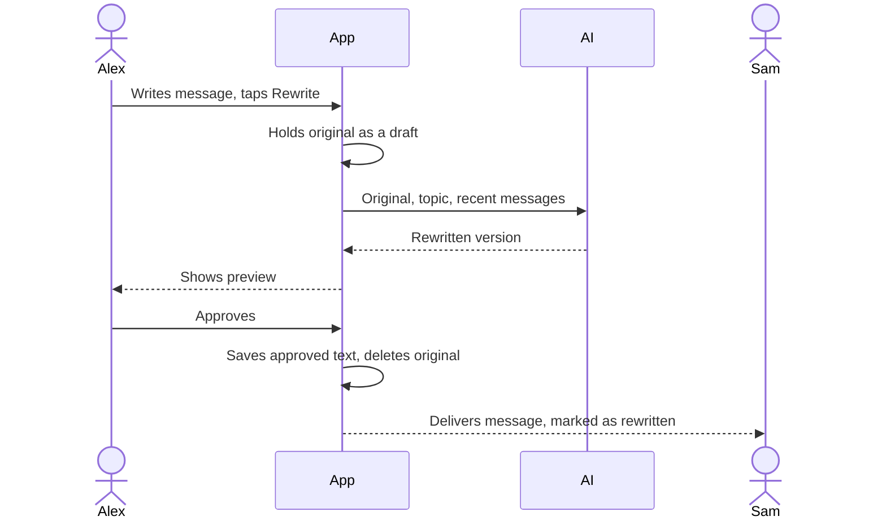
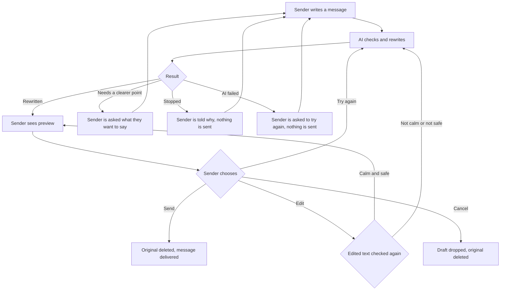
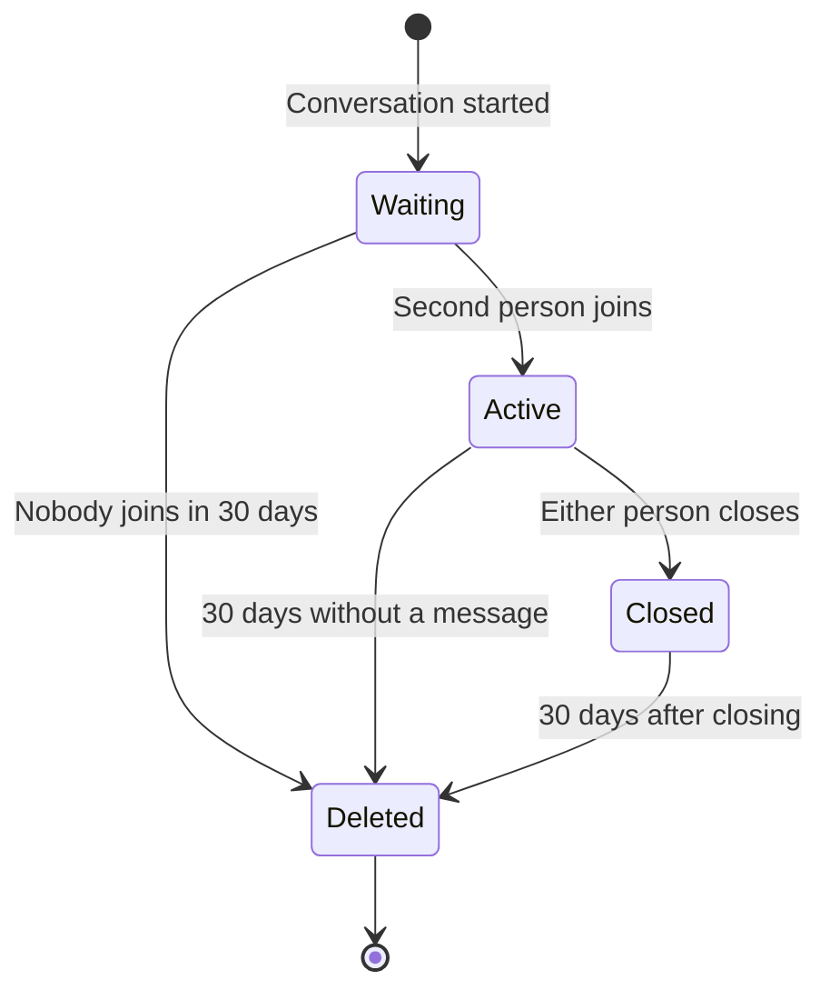

# Logical flows

The main flows of the first small version. "Alex" and "Sam" are example users.

## 1. Start a conversation and invite

1. Alex opens the app and taps Start.
2. Alex enters a display name and describes the problem in a line or two.
3. The app creates the conversation and gives Alex a private link back to it, plus an invite link for Sam.
4. Alex sends the invite link to Sam however they like, for example in a text message.
5. Sam opens the link and sees what the app does, what the topic is, and who invited them.
6. Sam enters a display name, confirms being 18 or over, and agrees to AI rewriting.
7. The invite link stops working, so nobody else can join. (If Alex loses the link before Sam joins, Alex can ask for a new one, which replaces the old.)
8. Both people are now in the chat.

## 2. Send a message

This is the core of the product.

1. Alex writes a message in their own words and taps Rewrite.
2. The app holds the original as a draft and sends it to the AI, with the topic and recent messages for context.
3. The AI returns one of three results: rewritten, needs a clearer point, or stopped.
4. If it's rewritten, Alex sees the new version and chooses: send, edit, try again, or cancel.
5. On send, the app saves the approved text, deletes the original, and delivers it to Sam.
6. Sam sees the message, marked as rewritten. Sam never sees the original.

## 3. What can happen to a draft

Every draft ends up either sent or dropped. A draft that isn't handled within one hour gets dropped.

Stopped covers threats, harassment and similar. If the words suggest someone may be in danger, the stopped screen also shows support links.

The edit check matters: without it, a person could type anything into the preview box and get around the rewrite.

## 4. Receive a message

1. Sam has the chat open, and the message appears right away.
2. If Sam is away, the message waits. It appears the next time Sam opens the private link.
3. Sam writes a reply, and it follows flow 2 in the other direction.

If Sam thinks a message is out of line, Sam can leave or close the conversation, or report it using the contact details.

## 5. Come back to a conversation

1. Alex opens the private link on the same phone or browser.
2. The app reads the saved token and matches it to Alex.
3. Alex sees the whole conversation.

If the link opens on a device with no saved token, the private link itself still works, so it has to be treated like a password. Each person's link is only theirs.

## 6. Close and delete

1. Either person taps Close and confirms.
2. No more messages can be written, by either person.
3. Both people see that it's closed, and when it'll be deleted.
4. The conversation stays readable until deletion.
5. A daily job deletes the conversation 30 days after it closes, or 30 days after the last message if nobody closed it.

